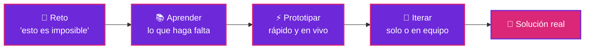

<div align="center">


**Desarrollador autodidacta de Ecatepec que construye herramientas para diseñar pipelines de datos y Machine Learning sin escribir scripts.**

<a href="mailto:garciaedahi382@gmail.com"></a>
<a href="https://github.com/Edahi98?tab=repositories"></a>


</div>

## 🧬 Mi bio, pero compila

```ts
const edahi: Developer = {
  nombre:     "Edahi Avila",
  origen:     "Ecatepec, Estado de México 🇲🇽",
  formacion:  "autodidacta por convicción",
  lenguajes:  ["TypeScript", "Python", "Rust", "Java", "C#", "JavaScript"],
  construyo:  "herramientas para armar pipelines de datos y ML sin escribir scripts",
  superpoder: "tomar desafíos que parecen imposibles y volverlos soluciones reales",
  trabajo:    ["en solitario", "en equipo"],
  valores:    ["adaptabilidad", "iniciativa", "trabajo en equipo"],
};

edahi.aprender();   // siempre
edahi.construir();  // todos los días
```

<br>

<div align="center">

</div>

## 🔀 Cómo convierto un reto imposible



<br>

<div align="center">

</div>

## 🛠️ Herramientas del taller

<p align="center">
  
</p>

<p align="center">
  
</p>

<br>

<div align="center">

</div>

## 🚀 Lo que estoy construyendo

<p align="center">
  
</p>

<table>
<tr>
<td width="50%" valign="top">

### ⚡ [Denki Pipeline Designer](https://github.com/Edahi98/DenkiPepelineDesigner)

Diseña pipelines de datos y Machine Learning arrastrando nodos en un canvas, sin escribir scripts.


</td>
<td width="50%" valign="top">

### 🪽 [TsubasaEngine](https://github.com/Edahi98/TsubasaEngine)

Convierte JSON en pipelines de datos, modelos de ML o gráficas interactivas listas para usar.


</td>
</tr>
</table>

<br>

<div align="center">

```console
$ git push origin main
> gracias por pasar 🎉
> ¿Colaboramos? → garciaedahi382@gmail.com
```


</div>
