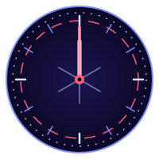
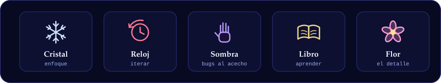
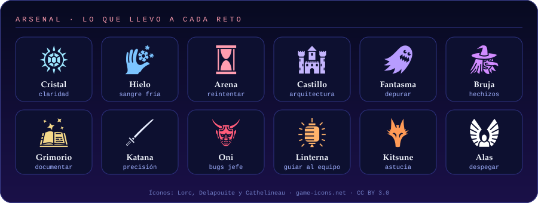
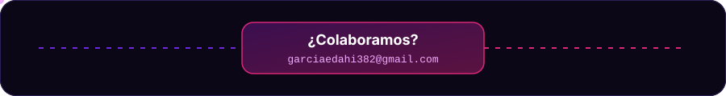

**Desarrollador autodidacta de Ecatepec que convierte retos que parecen imposibles en software que se usa de verdad.**

[✉️ garciaedahi382@gmail.com](mailto:garciaedahi382@gmail.com) · [📦 Mis repositorios](https://github.com/Edahi98?tab=repositories)

<h2 align="center"></h2>

<table>
<tr>
<td valign="top">

*Inspirado en Re:Zero: si algo falla, vuelvo al último checkpoint, aprendo y lo intento otra vez.*

|  |  |
|---|---|
| **Reto** | Desafíos que a primera vista parecen imposibles. |
| **Fallo** | Equivocarme es parte del proceso: vuelvo atrás sin rendirme. |
| **Aprendizaje** | Autodidacta por convicción: aprendo lo que haga falta, en solitario o en equipo, con adaptabilidad e iniciativa. |
| **Solución** | Soluciones reales, funcionando en el escritorio de quien las necesita. |

</td>
<td align="center" width="200" valign="middle">

</td>
</tr>
</table>

<h2 align="center"></h2>

**SECTIMonitor** es un sistema integral de escritorio que revisa las gacetas del Periódico Oficial del Estado de México y avisa cuando hay nuevas. Las convierte en presentaciones, infografías, resúmenes y diagramas, encuentra las páginas sobre un tema y permite sellarlas para clasificarlas. *(Repositorio privado.)*

<h2 align="center"></h2>

Íconos del Arsenal: [Lorc, Delapouite y Cathelineau en game-icons.net](https://game-icons.net), licencia [CC BY 3.0](https://creativecommons.org/licenses/by/3.0/). Detalles en [assets/CREDITS.md](assets/CREDITS.md).

 

